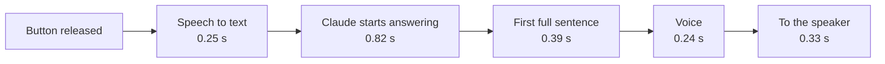

# tindra-speed-example

Simplified example from the video "M5Stack + Claude voice assistant: where every second goes"
(Vera tries something). Not Tindra's actual code: the real service streams audio, calls real
APIs and handles errors. Here the services are stand-ins with fixed waiting times.

Where the seconds go, from letting go of the button to the first sound (median of 86 questions
from Tindra's service log, Sonnet):



Total: 2.03 s. The model is the biggest block.

Three tricks in `tricks.py`:

1. **Start when they let go.** The work begins the moment the button is released. If the finger
   comes back, the work is thrown away.
2. **Warm up connections on press.** Opening a connection to a web service takes a few hundred
   milliseconds. Start it while the person is still talking.
3. **Time every link of the chain.** One timestamp per step, then you know where the seconds go.

```
python3 tricks.py
text             0.25 s after release
first_character  1.05 s after release
voice            1.65 s after release
```

License: MIT
